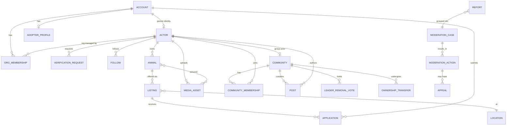

# Domain Model

Status: **Draft (Phase 0)**. Covers the MVP (Phases 1–3) in detail. Later phases are sketched so the early model doesn't block them. See [PLAN.md](PLAN.md) and [PERSONAS.md](PERSONAS.md).

## Design rules

1. **Everything that can post or be followed is an Actor.** Accounts, organizations, and community groups each have an Actor record with a stable URI, a key pair, and inbox/outbox URIs, all created at the start even though federation only arrives in Phase 5. This maps to ActivityPub `Person`, `Organization`, and `Group`.
2. **State changes are recorded as Activities.** Create/Update/Delete/Follow/Join/Flag events are written to an activity log in AP-compatible shape. The local app reads its own tables; the log becomes the outbox later.
3. **Animal ≠ Listing.** An Animal is a persistent record; a Listing is an offer (adoption, rehoming, later sale or foster) about that animal. An animal can be relisted without losing history.
4. **Public location is always approximate.** Precise addresses live in private fields that are shared only within an approved application.
5. **Deletes leave tombstones.** Deleted content is replaced by a minimal tombstone (AP `Tombstone`) so references, federation, and audits stay consistent.
6. **IDs are UUIDv7** (sortable by time). Public URIs use them: `https://{instance}/actors/{id}`, `/listings/{id}`, etc.

## Bounded contexts

| Context | Responsibility | Phase |
|---------|----------------|-------|
| Identity | Accounts, authentication, MFA, sessions | 1 |
| Actors | Actor records, keys, profiles, follows | 1 |
| Trust | Verification requests, tiers, badges, revocation | 1–2 |
| Organizations | Org profiles, staff memberships and roles | 2 |
| Media | Upload, processing, hashing, storage | 1 |
| Animals & Listings | Animal records, listings, search | 2 |
| Applications | Adopter profiles, applications, status | 2 |
| Communities | Groups, membership, posts, governance | 3 |
| Moderation | Reports, cases, actions, appeals | 2 |
| Audit | Append-only log of privileged actions | 1 |
| Federation | Delivery, remote actors, instance policy | 5 |

## Core entities (MVP)

### Identity and actors

**Account**: a login. `id`, `email` (unique, verified), `password_hash` (argon2id), `mfa_enabled`, `status` (active / restricted / suspended / banned / deleted), `created_at`, `last_active_at`.

**Actor**: the public identity. `id`, `type` (person / organization / group), `handle` (unique per instance), `display_name`, `summary`, `avatar_media_id`, `ap_id` (URI), `inbox_uri`, `outbox_uri`, `public_key`, `private_key_ref` (encrypted), `is_local`, `instance_id` (for remote actors later), `approx_location_id`.

- A person Actor belongs to exactly one Account.
- An organization Actor is managed by Accounts through **OrgMembership**.
- A group Actor is managed through **CommunityMembership**.

**Follow**: `follower_actor_id`, `followee_actor_id`, `state` (pending / accepted).

### Trust

**TrustTier** (enum): `unverified`, `id_verified`, `verified_org`, `verified_breeder` (Phase 6), `verified_sitter` (Phase 7).

**VerificationRequest**: `id`, `actor_id`, `tier_requested`, `evidence` (references to private documents and media), `status` (submitted / in_review / approved / rejected / revoked / expired), `reviewed_by`, `reviewed_at`, `expires_at`, `checks_performed` (structured list, shown in badge wording, e.g. "EIN checked against IRS registry on 2026-11-02").

**Badge**: derived from the latest approved, unexpired VerificationRequest. It's computed rather than stored, so revocation takes effect immediately.

### Organizations

**OrgMembership**: `org_actor_id`, `account_id`, `role` (owner / admin / staff), `invited_by`, `joined_at`. Verified orgs require MFA for all members.

### Location

**Location**: `id`, `precise_point` (PostGIS, private), `public_point` (snapped to ~1–2 km grid or postal-code centroid), `locality`, `region`, `country`. Search uses only `public_point`.

### Media

**MediaAsset**: `id`, `owner_actor_id`, `status` (pending / processing / ready / rejected / quarantined), `mime_type` (image types only), `width`, `height`, `bytes`, `storage_key`, `sha256`, `perceptual_hash` (PDQ), `alt_text`, `created_at`.

Pipeline: upload → size/type check → decode and re-encode (EXIF stripped) → hash → check against the CSAM hash list and against existing listings (stolen photos) → `ready` or `rejected`/`quarantined`.

### Animals and listings

**Animal**: `id`, `owner_actor_id` (org or person), `name`, `species`, `breed_primary`, `breed_secondary`, `mixed`, `sex`, `age_estimate`, `size`, `color`, `spay_neuter_status`, `microchipped`, `good_with` (kids/dogs/cats, tri-state: yes / no / unknown), `special_needs`, `description`, `media_ids`, `external_ref` (import source + ID).

**Listing**: `id`, `animal_id`, `kind` (adoption / rehoming; later foster, sale), `fee_amount`, `fee_currency`, `fee_type` (adoption / rehoming / sale), `location_id`, `status`, `published_at`, `expires_at`, `application_questions` (optional custom questions).

Listing status flow:

```
draft ──▶ published ──▶ pending ──▶ adopted
            │  ▲          │
            │  └──────────┘ (application fell through)
            ├──▶ withdrawn
            └──▶ expired  (no refresh within N days; prevents stale listings)
any ──▶ quarantined (moderation) ──▶ previous state | removed
```

**Breed**: reference table with species, canonical name, and aliases (used for search normalization).

### Applications

**AdopterProfile**: `account_id`, reusable household details (housing type, landlord permission, other pets, children, experience, yard). Private, and shared only through an Application.

**Application**: `id`, `listing_id`, `applicant_account_id`, `profile_snapshot` (copy of the AdopterProfile at submission), `answers`, `status`, `assigned_to` (org member), `internal_notes` (org-only), `created_at`, `updated_at`.

Application status flow:

```
submitted ──▶ under_review ──▶ approved ──▶ completed
    │              │              └──▶ fell_through
    │              └──▶ declined
    └──▶ withdrawn (by applicant, from any open state)
```

Precise location and contact details are shown to the applicant only once the application is `approved`. Application data has a retention period (see the threat model).

### Communities (Phase 3)

**Community**: a group Actor plus `rules`, `visibility` (public / members-only), `join_policy` (open / approval), `home_location_id` (optional).

**CommunityMembership**: `community_id`, `actor_id`, `role` (owner / moderator / member), `status` (active / banned / left), `joined_at`, `last_active_at`.

**Post**: `id`, `author_actor_id`, `community_id` (nullable for profile posts), `kind` (general / lost_pet / found_pet), `body`, `media_ids`, `location_id` (lost/found only), `in_reply_to_id`, `status` (visible / quarantined / removed / tombstoned).

**OwnershipTransfer**: `community_id`, `from_actor_id`, `to_actor_id`, `status` (offered / accepted / declined / cancelled).

**LeaderRemovalVote**: `community_id`, `target_actor_id`, `initiated_by`, `reason` (inactivity), `opens_at`, `appeal_until`, `closes_at`, `quorum_required`, `status` (open / passed / failed / appealed / admin_confirmed). **Ballot**: `vote_id`, `voter_actor_id`, `choice`. Voters must meet eligibility rules (account age, tier, prior participation in the community).

### Moderation

**Report**: `id`, `reporter_actor_id`, `subject_type` (actor / listing / post / media / application), `subject_id`, `category` (scam / impersonation / harassment / spam / animal_welfare / illegal / csam / other), `details`, `created_at`.

**ModerationCase**: groups reports about one subject. `scope` (community / instance), `assigned_to`, `status` (open / actioned / dismissed), `priority` (CSAM and imminent harm are highest).

**ModerationAction**: `case_id`, `action` (warn / restrict / quarantine / suspend / ban / remove_content / revoke_verification), `target`, `reason`, `expires_at`, `actor_account_id`.

**Appeal**: `action_id`, `appellant`, `statement`, `status`, `decided_by`.

Community moderators act within their community. Instance admins act instance-wide, but only for safety, legal, or ToS reasons.

### Audit

**AuditEvent** (append-only): `id`, `at`, `actor_account_id`, `action`, `subject_type`, `subject_id`, `before`, `after`, `ip_hash`. Covers verification decisions, moderation actions, role changes, admin access to private data, and exports.

## Relationships



## ActivityPub mapping (for Phase 5)

| Domain | AP type | Notes |
|--------|---------|-------|
| Person actor | `Person` | |
| Organization actor | `Organization` | Verification badge exposed as a signed attestation or attachment, never trusted from remote instances without that instance being allow-listed |
| Community | `Group` | FEP-1b12: group `Announce`s member posts |
| Listing | `Note` or `Page` with custom extension properties | Pet-specific fields under a project JSON-LD namespace |
| Post | `Note` | |
| Follow / Join | `Follow` | |
| Report | `Flag` | Forwarded to the remote instance on request |
| Delete | `Delete` → `Tombstone` | |

**Not federated by default:** applications, adopter profiles, verification evidence, moderation internals, sitter listings (Phase 7), and breeder listings unless policy allows (Phase 6).

## Later-phase sketches

- **Fostering (Phase 4):** `FosterProfile` (capacity, species, constraints), `FosterPlacement` (animal, foster, org, dates, status), progress `Updates`.
- **Federation (Phase 5):** `Instance` (domain, policy: allow / limit / block, notes), `RemoteActor` cache, `DeliveryJob` (river queue).
- **Breeders (Phase 6):** `BreederProfile` (license refs, listing cap), `Listing.kind = sale`, `Review`.
- **Sitting (Phase 7, feature flag):** `SitterProfile` (rates, service area, insurance certificate ref and expiry), `Availability`, `SittingRequest`, `Review`, `IncidentReport`.

## Open modeling questions

- Should a person be able to rehome pets without ID verification, with stricter limits? (Persona 4 suggests no.)
- Should species-specific attributes be fixed columns or a typed JSONB extension?
- Which import format should come first: Petfinder, RescueGroups, or a CSV template? This will shape `external_ref` and field mapping.
- Should application data be removed after a retention period (e.g. 12 months after closure)?
